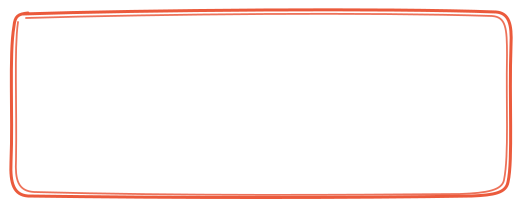

# Abhijith S Lal — UI/UX Designer Portfolio 🎨📓

A playful, retro-modern, handcrafted notebook portfolio website inspired by high-craft digital paper design, tactile micro-interactions, and 8-bit typography.



---

## ✨ Features

- **Pixel-Perfect Hero Section**:
  - Ruled notebook paper background texture with subtle margin lines.
  - Hand-drawn coral/orange sketch box around the retro pixel display name (`ABHIJITH S LAL`).
  - Playful pill badges: `MADE THINGS` and `PIXEL PERFECT`.
  - Handwritten annotations: `my name is` with doodle underline, yellow tape `UI/UX Designer`, and mint tape `Kerala, India` with hand-drawn doodle arrows.
  - Live status indicator: `● OPEN TO NEW WORK AND GOOD PROBLEMS`.
  - Bold headline: *"Designing digital experiences that [Target] feel effortless and look unforgettable. [Flower]"* flanked by circular outdoor portraits with vibrant coral border rings.
  - Black `CONTACT ME` CTA button with blue diagonal arrow square `↗`.

- **Delightful Micro-Interactions**:
  - **Web Audio Retro Chimes**: In-browser audio oscillator synthesis producing tactile clicks, pops, and chimes (zero external audio files).
  - **Interactive Pink Smiley Button**: Click to trigger festive chimes and confetti bursts.
  - **Parallax Tilt**: Organic 3D perspective response on the sketch box when moving the mouse.
  - **Live Kerala (IST) Clock**: Real-time Indian Standard Time clock widget with active status pill.

- **Complete Sections**:
  - **My Projects**: 5 in-depth featured projects (`Pixel Brew`, `Linear Mobile 2.0`, `Canvas Flow`, `Palette Studio`, `Zenith EHR`) with washi tape badges, impact metrics, live Figma prototype integration, and interactive quick-view modal dialogs.
  - **About Me**: Polaroid photo with washi tape, design philosophy sticky notes, dedicated **Tools & Software** (Figma, Adobe Photoshop, Adobe Illustrator, Adobe XD), and a dedicated **Skills & Specializations** section (Prototyping, Visual Designing, UX Design, HTML, CSS, JavaScript).
  - **Playground (Creative Lab)**:
    - *Sticker Board*: Stamp, drag, rotate, and clear custom stickers directly on the digital notebook.
    - *12×12 Retro Pixel Studio*: Interactive pixel art painting grid with 7-color palette and 1-click PNG export!
  - **Contact Section**: Vintage memo card inquiry form with real-time validation, confetti feedback, and instant "Copy Direct Email" toast notification.

- **"USE THIS TEMPLATE" Live Customizer**:
  - Click the floating badge in the bottom-right corner to open the live customizer drawer.
  - Change your name, role, city, headline, and status in real-time, then export your customized portfolio with one click!

---

## 🚀 How to Run

Because this project is built with vanilla HTML5, CSS3, and modern JavaScript with zero build steps or package dependencies:

1. **Directly in Browser**:
   - Double-click [`index.html`](index.html) or open it with your favorite browser (Chrome, Edge, Firefox, Safari).

2. **Using any Local Server**:
   ```powershell
   # Python (if installed)
   python -m http.server 3000

   # Or npx serve
   npx serve .
   ```

---

## 📁 File Structure

```text
c:\portfolio\
├── index.html              # Main semantic HTML structure
├── styles.css              # Notebook paper lines, typography, animations, responsive rules
├── script.js               # Web Audio synthesizer, modals, sticker board, pixel studio, customizer
├── README.md               # Documentation
└── assets\
    ├── arrow-left.svg       # Hand-drawn arrow pointing up-right
    ├── arrow-right.svg      # Hand-drawn arrow pointing up-left
    ├── avatar-left.svg      # Circular outdoor portrait with coral ring
    ├── avatar-right.svg     # Circular mountain profile with coral ring
    ├── hand-underline.svg   # Hand-drawn script underline doodle
    ├── sketch-box.svg       # Organic hand-drawn orange marker box
    ├── sticker-flower.svg   # Pink 5-petal flower sticker
    ├── sticker-target.svg   # Green concentric bullseye target sticker
    ├── robin-pixel.svg      # Crisp 8-bit pixel art vector logo
    ├── stickers.svg         # Playground sticker defs
    ├── project-linear.svg   # Case study UI mockup (Linear Mobile)
    ├── project-canvas.svg   # Case study UI mockup (Canvas Flow)
    ├── project-palette.svg  # Case study UI mockup (Palette Studio)
    └── project-health.svg   # Case study UI mockup (Zenith EHR)
```
